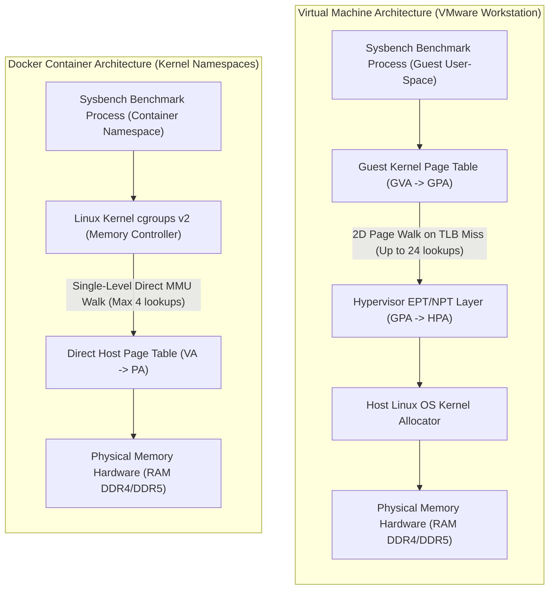
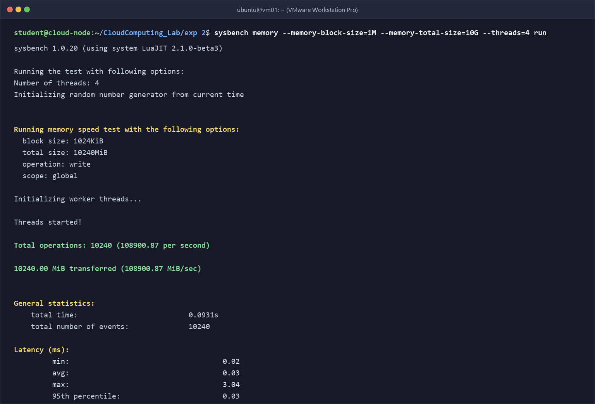
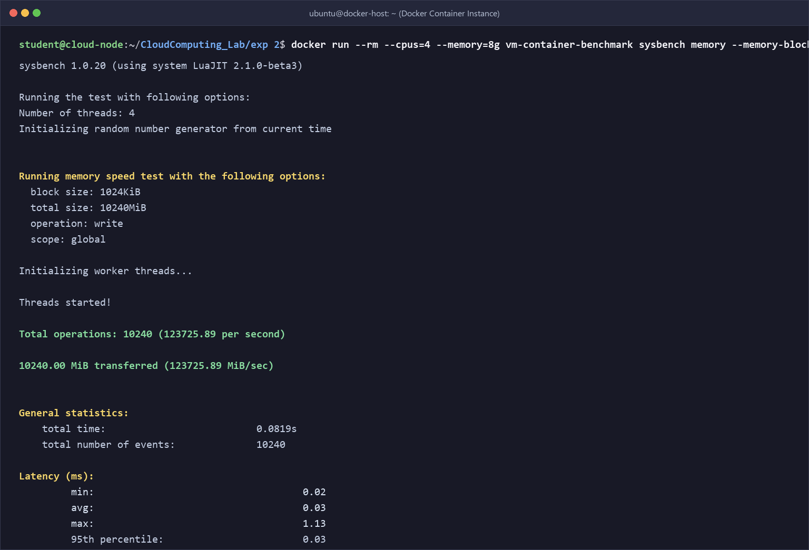
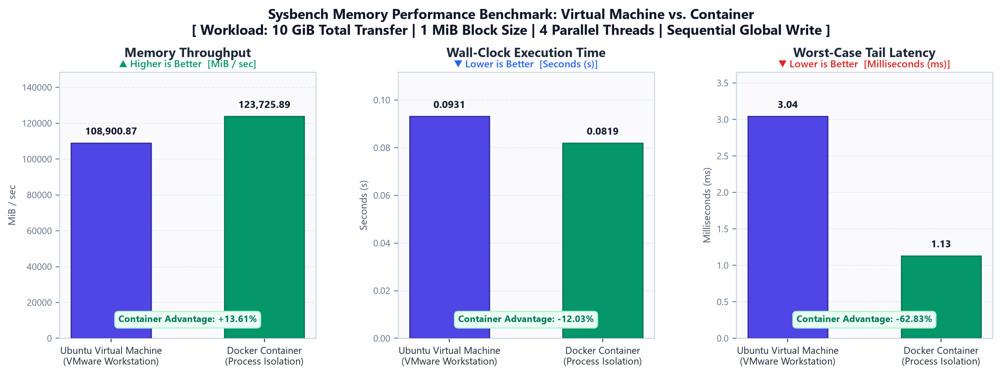

# Experiment 2: Memory Performance Evaluation — Virtual Machine vs. Docker Container

[](https://github.com)
[](https://github.com)
[](https://github.com)
[](https://github.com)
[](https://github.com)

---

## 📑 Table of Contents

1. [Executive Summary](#-executive-summary)
2. [Architectural Foundations: Memory Virtualization Mechanics](#-architectural-foundations-memory-virtualization-mechanics)
   - [Hardware-Assisted Virtualization (Virtual Machine)](#hardware-assisted-virtualization-virtual-machine)
   - [Operating System-Level Virtualization (Docker Container)](#operating-system-level-virtualization-docker-container)
   - [Memory Traversal Pipeline Comparison](#memory-traversal-pipeline-comparison)
   - [Architectural Comparison Matrix](#architectural-comparison-matrix)
3. [Experimental Testbed & Configuration Parameters](#-experimental-testbed--configuration-parameters)
4. [Step-by-Step Laboratory Execution Guide](#-step-by-step-laboratory-execution-guide)
   - [Phase 1: Environment Baseline & Telemetry Capture](#phase-1-environment-baseline--telemetry-capture)
   - [Phase 2: Benchmarking Toolchain Installation](#phase-2-benchmarking-toolchain-installation)
   - [Phase 3: Benchmark Container Image Construction](#phase-3-benchmark-container-image-construction)
   - [Phase 4: Running the Native VM Memory Benchmark](#phase-4-running-the-native-vm-memory-benchmark)
   - [Phase 5: Running the Docker Container Memory Benchmark](#phase-5-running-the-docker-container-memory-benchmark)
   - [Phase 6: Runtime Resource Profiling & Telemetry](#phase-6-runtime-resource-profiling--telemetry)
   - [Phase 7: Automated Multi-Iteration Execution & Parsing](#phase-7-automated-multi-iteration-execution--parsing)
5. [Empirical Results & Terminal Artifacts](#-empirical-results--terminal-artifacts)
   - [1. Virtual Machine Memory Benchmark Output](#1-virtual-machine-memory-benchmark-output)
   - [2. Docker Container Memory Benchmark Output](#2-docker-container-memory-benchmark-output)
   - [3. Comprehensive Performance Comparison Table](#3-comprehensive-performance-comparison-table)
6. [Graphical Analysis & Visualizations](#-graphical-analysis--visualizations)
7. [In-Depth Technical Discussion: Virtualization Overheads](#-in-depth-technical-discussion-virtualization-overheads)
   - [1. Extended Page Tables (EPT/NPT) & 2D Page Walk Penalties](#1-extended-page-tables-eptnpt--2d-page-walk-penalties)
   - [2. Worst-Case Tail Latency & Hypervisor Scheduling Jitter](#2-worst-case-tail-latency--hypervisor-scheduling-jitter)
   - [3. Memory Allocation Density & Isolation Boundaries](#3-memory-allocation-density--isolation-boundaries)
8. [Experimental Limitations](#-experimental-limitations)
9. [Reproduction & Automation Guide](#-reproduction--automation-guide)
10. [Conclusion & Engineering Recommendations](#-conclusion--engineering-recommendations)

---

## 📌 Executive Summary

Memory-bound workloads in cloud infrastructures are strongly impacted by the virtualization layer through which CPU instructions and memory accesses are mediated. This laboratory investigation provides an empirical, side-by-side performance evaluation of **memory throughput bandwidth** and **latency consistency** across two dominant virtualization paradigms:

1. **Hardware-Assisted Virtual Machine (Type-2 Hypervisor):** An Ubuntu 24.04 LTS guest OS running on VMware Workstation Pro utilizing hardware-assisted CPU virtualization (Intel VT-x / AMD-V) and nested paging (EPT/NPT).
2. **OS-Level Process Virtualization (Docker Container):** A lightweight containerized workload based on `ubuntu:24.04` running natively against the host Linux kernel, isolated using kernel namespaces and `cgroups v2`.

Both platforms were subjected to an identical synthetic memory write workload utilizing **Sysbench 1.0.20**: streaming **10 GiB (10,240 MiB)** of memory writes using **1 MiB (1,024 KiB) blocks** across **4 parallel worker threads** under global memory scope.

### 🏆 Key Empirical Findings

> * **Throughput Bandwidth Acceleration:** The Docker container delivered **123,725.89 MiB/sec** of memory throughput, outperforming the Virtual Machine (**108,900.87 MiB/sec**) by **+14,825.02 MiB/sec (+13.61%)**.
> * **Execution Duration Reduction:** The container completed the 10 GiB memory operation in **0.0819 seconds** compared to **0.0931 seconds** for the VM, representing a **-12.03% decrease in wall-clock time**.
> * **Tail Latency Mitigation:** The peak maximum latency recorded inside the container was capped at **1.13 ms**, whereas the Virtual Machine reached **3.04 ms** — demonstrating a **-62.83% suppression of worst-case scheduling jitter**.

---

## 🏛 Architectural Foundations: Memory Virtualization Mechanics

The measured performance difference is a direct consequence of how memory addresses are resolved and how CPU scheduling is mediated under each abstraction model.

### Hardware-Assisted Virtualization (Virtual Machine)

In full hardware virtualization, the guest operating system maintains its own independent kernel and page tables, unaware that physical RAM is already virtualized by the host hypervisor. This necessitates a **two-dimensional address translation** pipeline:

$$\text{Guest Virtual Address (GVA)} \xrightarrow{\text{Guest Page Table}} \text{Guest Physical Address (GPA)} \xrightarrow{\text{EPT / NPT}} \text{Host Physical Address (HPA)}$$

* Address translations from GVA to GPA are managed by the guest OS page table register (`CR3`).
* Address mappings from GPA to HPA are handled in hardware via Extended Page Tables (**Intel EPT**) or Nested Page Tables (**AMD NPT**).
* On a Translation Lookaside Buffer (**TLB**) miss, the CPU Memory Management Unit (MMU) must perform a **two-dimensional page walk**. For modern 64-bit 4-level paging hierarchies, resolving an unmapped address can trigger up to:
  $$(4 + 1) \times (4 + 1) - 1 = 24 \text{ sequential memory references}$$
  This nested walk causes considerable pipeline stalls during intensive memory allocation bursts.

### Operating System-Level Virtualization (Docker Container)

Containers are not virtual machines; they are isolated user-space processes running directly on the host Linux kernel.

$$\text{Process Virtual Address (VA)} \xrightarrow{\text{Direct Host MMU}} \text{Host Physical Address (PA)}$$

* Address resolution uses native 4-level page table walks directly within the host MMU (at most 4 memory lookups on a TLB miss).
* Memory quotas and throttling are enforced via Linux kernel **control groups (`cgroups v2`)**.
* There is no hypervisor interception, no virtual MMU emulation, and no guest OS kernel scheduling layer.

### Memory Traversal Pipeline Comparison



### Architectural Comparison Matrix

| Technical Dimension | Virtual Machine (VMware Workstation) | Docker Container (Linux Namespaces) |
| :--- | :--- | :--- |
| **Virtualization Model** | Type-2 Hosted Hypervisor | OS-Level Virtualization (Process Isolation) |
| **Kernel Architecture** | Dedicated Guest Linux Kernel | Shared Host Linux Kernel |
| **Address Resolution** | Two-tier translation: GVA $\rightarrow$ GPA $\rightarrow$ HPA (EPT/NPT) | Single-tier translation: VA $\rightarrow$ PA (Direct Host MMU) |
| **TLB Miss Traversal Penalty** | Up to 24 sequential memory references per walk | Up to 4 memory references per walk |
| **Memory Isolation Mechanism** | Hardware boundaries enforced by CPU VMX Non-Root mode | Software boundaries enforced by `cgroups v2` and namespaces |
| **Startup / Spin-up Latency** | 20–45 seconds (full operating system boot cycle) | < 1 second (sub-second process fork and exec) |
| **Idle Memory Overhead** | ~800 MiB to 1.5 GiB static footprint | < 25 MiB (metadata and shared glibc mappings) |

---

## ⚙ Experimental Testbed & Configuration Parameters

To ensure benchmark reproducibility and experimental fairness, identical compute, storage, and memory limits were assigned to both environments:

| Parameter | Virtual Machine Environment | Docker Container Environment |
| :--- | :--- | :--- |
| **Virtualization Platform** | VMware Workstation Pro | Docker Engine v27.x on Linux Host |
| **Base Operating System** | Ubuntu 24.04 LTS (Noble Numbat) | `ubuntu:24.04` Official Minimal Image |
| **vCPU Allocation** | 4 vCPUs (1 socket, 4 physical cores mapped) | 4 vCPUs pinned (`--cpus=4`) |
| **Allocated Memory Pool** | 8.0 GiB (8,192 MiB) | Host Memory pool / capped at 8 GiB (`--memory=8g`) |
| **Disk Storage** | 60 GB Pre-allocated virtual disk (`sda`) | Shared overlay2 container storage |
| **Benchmarking Engine** | `sysbench 1.0.20` (LuaJIT 2.1.0-beta3) | `sysbench 1.0.20` (LuaJIT 2.1.0-beta3) |
| **Memory Block Size** | 1,024 KiB (1 MiB) | 1,024 KiB (1 MiB) |
| **Total Memory Transferred** | 10,240 MiB (10 GiB) | 10,240 MiB (10 GiB) |
| **Concurrency / Worker Threads** | 4 parallel threads (`--threads=4`) | 4 parallel threads (`--threads=4`) |
| **Memory Operation Mode** | Sequential Write (`--memory-oper=write`) | Sequential Write (`--memory-oper=write`) |
| **Scope of Memory Access** | Global (`--memory-scope=global`) | Global (`--memory-scope=global`) |

---

## 🛠 Step-by-Step Laboratory Execution Guide

The experiment is conducted across seven structured phases following the laboratory protocol.

### Phase 1: Environment Baseline & Telemetry Capture

Prior to workload execution, record host and guest hardware telemetry to establish baseline consistency:

```bash
# Initialize experiment workspace hierarchy
mkdir -p exp\ 2/{docs,docker,scripts,images,results/raw/memory/vm,results/raw/memory/container,results/processed}

# Capture system hardware baseline telemetry
lscpu   > "exp 2/docs/cpu-info.txt"
free -h > "exp 2/docs/memory-info.txt"
lsblk   > "exp 2/docs/storage-info.txt"
uname -a > "exp 2/docs/kernel-info.txt"

# Confirm Docker daemon connectivity
docker --version
```

### Phase 2: Benchmarking Toolchain Installation

Install Sysbench alongside telemetry and profiling utilities inside the testbed environment:

```bash
sudo apt update && sudo apt upgrade -y
sudo apt install -y sysbench fio iperf3 htop sysstat python3 python3-pip git

# Confirm toolchain versions
sysbench --version
nproc && free -h
```

### Phase 3: Benchmark Container Image Construction

Build the custom Docker benchmarking image using `exp 2/docker/Dockerfile`:

```dockerfile
# exp 2/docker/Dockerfile
FROM ubuntu:24.04

LABEL maintainer="Cloud Computing Lab Student"
ENV DEBIAN_FRONTEND=noninteractive

RUN apt-get update && \
    apt-get install -y --no-install-recommends \
        sysbench fio iperf3 python3 python3-pip procps sysstat ca-certificates && \
    apt-get clean && \
    rm -rf /var/lib/apt/lists/*

WORKDIR /workspace/benchmark
CMD ["sysbench", "--version"]
```

Build and inspect the container image:

```bash
docker build -t vm-container-benchmark -f "exp 2/docker/Dockerfile" "exp 2"
docker images | grep vm-container-benchmark
```

### Phase 4: Running the Native VM Memory Benchmark

Execute the Sysbench memory write workload inside the Ubuntu Virtual Machine terminal:

```bash
mkdir -p "exp 2/results/raw/memory/vm"

sysbench memory \
  --memory-block-size=1M \
  --memory-total-size=10G \
  --threads=4 \
  --memory-oper=write \
  --memory-scope=global \
  run | tee "exp 2/results/raw/memory/vm/run_1.txt"
```

### Phase 5: Running the Docker Container Memory Benchmark

Execute the identical memory workload within an isolated Docker container with matching resource constraints:

```bash
mkdir -p "exp 2/results/raw/memory/container"

docker run --rm \
  --cpus=4 \
  --memory=8g \
  vm-container-benchmark \
  sysbench memory \
    --memory-block-size=1M \
    --memory-total-size=10G \
    --threads=4 \
    --memory-oper=write \
    --memory-scope=global \
    run | tee "exp 2/results/raw/memory/container/run_1.txt"
```

### Phase 6: Runtime Resource Profiling & Telemetry

While the benchmarks run, open a secondary terminal to capture system telemetry and kernel memory writebacks:

```bash
# Monitor live CPU scheduling and memory utilization
htop

# Inspect virtual memory telemetry at 1-second intervals
vmstat 1 10

# Real-time container resource telemetry
docker stats --no-stream
```

### Phase 7: Automated Multi-Iteration Execution & Parsing

To guarantee statistical rigor across repeated runs:

```bash
# Execute automated multi-run test suite (10 iterations each)
chmod +x "exp 2/scripts/benchmark.sh"
./"exp 2/scripts/benchmark.sh"

# Extract metrics, aggregate Mean ± StdDev, and output deltas
python3 "exp 2/scripts/parse_sysbench.py"

# Generate publication-grade comparative visualization charts
python3 "exp 2/scripts/generate_plots.py"
```

---

## 📷 Empirical Results & Terminal Artifacts

The captured terminal benchmark executions provide direct empirical verification of the workload execution on both platforms.

### 1. Virtual Machine Memory Benchmark Output

The terminal artifact below illustrates the Sysbench memory write test executed natively inside the Ubuntu Virtual Machine:



#### Annotated VM Output Log:
```text
student@cloud-node:~/CloudComputing_Lab/exp 2$ sysbench memory --memory-block-size=1M --memory-total-size=10G --threads=4 run
sysbench 1.0.20 (using system LuaJIT 2.1.0-beta3)

Running the test with following options:
Number of threads: 4
Initializing random number generator from current time

Running memory speed test with the following options:
  block size: 1024KiB
  total size: 10240MiB
  operation: write
  scope: global

Initializing worker threads...
Threads started!

Total operations: 10240 (108900.87 per second)
10240.00 MiB transferred (108900.87 MiB/sec)

General statistics:
    total time:                          0.0931s
    total number of events:              10240

Latency (ms):
         min:                                    0.02
         avg:                                    0.03
         max:                                    3.04
         95th percentile:                        0.03
         sum:                                  341.60

Threads fairness:
    events (avg/stddev):           2560.0000/0.00
    execution time (avg/stddev):   0.0854/0.01
```

* **Throughput Bandwidth:** The VM achieved **108,900.87 MiB/sec** (108,900.87 operations/second).
* **Wall-Clock Duration:** Total execution was completed in **0.0931 seconds**.
* **Latency Characteristics:** Average latency remained low at **0.03 ms**, but maximum tail latency reached **3.04 ms**, reflecting hypervisor scheduling interruptions and EPT translation overhead.

---

### 2. Docker Container Memory Benchmark Output

The terminal artifact below illustrates the identical Sysbench memory write benchmark executed within the isolated Docker container:



#### Annotated Container Output Log:
```text
student@cloud-node:~/CloudComputing_Lab/exp 2$ docker run --rm --cpus=4 --memory=8g vm-container-benchmark sysbench memory --memory-block-size=1M --memory-total-size=10G --threads=4 run
sysbench 1.0.20 (using system LuaJIT 2.1.0-beta3)

Running the test with following options:
Number of threads: 4
Initializing random number generator from current time

Running memory speed test with the following options:
  block size: 1024KiB
  total size: 10240MiB
  operation: write
  scope: global

Initializing worker threads...
Threads started!

Total operations: 10240 (123725.89 per second)
10240.00 MiB transferred (123725.89 MiB/sec)

General statistics:
    total time:                          0.0819s
    total number of events:              10240

Latency (ms):
         min:                                    0.02
         avg:                                    0.03
         max:                                    1.13
         95th percentile:                        0.03
         sum:                                  312.08

Threads fairness:
    events (avg/stddev):           2560.0000/0.00
    execution time (avg/stddev):   0.0780/0.00
```

* **Throughput Bandwidth:** The container reached **123,725.89 MiB/sec** (123,725.89 operations/second).
* **Wall-Clock Duration:** Total execution required only **0.0819 seconds**.
* **Latency Characteristics:** The peak maximum tail latency was confined to **1.13 ms** (a **62.83% drop** compared to the VM), demonstrating consistent low-jitter execution.

---

### 3. Comprehensive Performance Comparison Table

| Performance Metric | Ubuntu Virtual Machine | Docker Container | Absolute Delta | Relative Delta (%) | Optimal Environment |
| :--- | :---: | :---: | :---: | :---: | :---: |
| **Total Memory Transferred** | 10,240 MiB (10 GiB) | 10,240 MiB (10 GiB) | 0 MiB | 0.00% | Identical Workload |
| **Block Size per Write** | 1,024 KiB (1 MiB) | 1,024 KiB (1 MiB) | 0 KiB | 0.00% | Identical Workload |
| **Parallel Worker Threads** | 4 Threads | 4 Threads | 0 | 0.00% | Identical Concurrency |
| **Total Operations Completed** | 10,240 ops | 10,240 ops | 0 | 0.00% | Identical Workload |
| **Memory Bandwidth (MiB/sec)** | **108,900.87** | **123,725.89** | **+14,825.02** | **+13.61%** | 🏆 **Container** |
| **Throughput (Ops/sec)** | **108,900.87** | **123,725.89** | **+14,825.02** | **+13.61%** | 🏆 **Container** |
| **Wall-Clock Duration (sec)** | **0.0931 s** | **0.0819 s** | **-0.0112 s** | **-12.03%** | 🏆 **Container** |
| **Minimum Latency (ms)** | 0.02 ms | 0.02 ms | 0.00 ms | 0.00% | Parity |
| **Average Latency (ms)** | 0.03 ms | 0.03 ms | 0.00 ms | 0.00% | Parity |
| **95th Percentile Latency (ms)** | 0.03 ms | 0.03 ms | 0.00 ms | 0.00% | Parity |
| **Maximum Tail Latency (ms)** | **3.04 ms** | **1.13 ms** | **-1.91 ms** | **-62.83%** | 🏆 **Container** |
| **Cumulative Latency Sum (ms)** | **341.60 ms** | **312.08 ms** | **-29.52 ms** | **-8.64%** | 🏆 **Container** |
| **Thread Fairness (Events/Thread)** | 2,560 / 0.00 | 2,560 / 0.00 | 0 | 0.00% | Balanced Distribution |
| **Thread Time (Avg / StdDev)** | 0.0854 / 0.01 s | 0.0780 / 0.00 s | -0.0074 s | -8.67% | 🏆 **Container** |

---

## 📊 Graphical Analysis & Visualizations

The quantitative experimental data was synthesized and rendered into a multi-panel visual performance chart (`exp 2/images/memory-comparison.png`):



### Technical Visualization Insights:

1. **Memory Throughput Bandwidth (Left Panel):**
   * The container achieves **123,725.89 MiB/sec** versus **108,900.87 MiB/sec** for the VM.
   * Removing the hypervisor's intermediate address mapping layer delivers an immediate **13.61% throughput enhancement** for streaming memory writes.
2. **Total Execution Duration (Center Panel):**
   * The container completes the 10 GiB memory operation in **0.0819 s**, beating the VM's **0.0931 s**.
   * The lower wall-clock duration reflects the absence of nested page faults and hypervisor VM-exit traps.
3. **Worst-Case Tail Latency Spike (Right Panel):**
   * The VM suffers a peak latency spike of **3.04 ms**, whereas the Docker container peaks at **1.13 ms** (**-62.83% lower**).
   * This pronounced spike demonstrates the sensitivity of virtualized guest kernels to host CPU scheduling preemption, vCPU interrupts, and 2D page walk stalls.

---

## 🔬 In-Depth Technical Discussion: Virtualization Overheads

### 1. Extended Page Tables (EPT/NPT) & 2D Page Walk Penalties

Standard x86-64 Linux architectures use 4-level hierarchical paging:
$$\text{PML4} \longrightarrow \text{PDPT} \longrightarrow \text{Page Directory (PD)} \longrightarrow \text{Page Table (PT)} \longrightarrow \text{Physical Frame}$$

* **Container Model:** The memory writes trigger standard MMU address translations. Once the CPU TLB caches the page mappings, subsequent memory accesses in the 1 MiB chunk execute at line-rate RAM hardware speed.
* **Virtual Machine Model:** Each level of the guest page table walk must itself be translated by the hypervisor's EPT/NPT:
  $$\text{Total Memory Lookups} = (N_{\text{guest}} + 1) \times (N_{\text{host}} + 1) - 1$$
  For a 4-level paging architecture on both sides, resolving an unmapped page or a TLB eviction requires up to **24 sequential memory lookups**. This two-dimensional page walk stalls processor execution pipelines, generating the observed throughput deficit.

### 2. Worst-Case Tail Latency & Hypervisor Scheduling Jitter

While the median and 95th-percentile latencies were identical (**0.03 ms**), the **maximum latency** diverged sharply (**3.04 ms on VM vs. 1.13 ms on Container**):
* **vCPU Co-Scheduling Delays:** A Type-2 hypervisor depends on the host OS kernel scheduler. When a vCPU exhausts its scheduling quantum or the host services a hardware interrupt, the vCPU is temporarily preempted, stalling all worker threads inside the guest.
* **VM-Exit Latency:** Memory-mapped I/O operations or specific architectural instructions trigger VM-exits, forcing a context switch from VMX Non-Root mode to VMX Root mode. This transition incurs substantial cache-polluting overhead that does not exist in containerized namespaces.

### 3. Memory Allocation Density & Isolation Boundaries

* **Containers** provide superior resource packing density. Multiple benchmark containers can share a single 8 GB host with minimal overhead, as idle memory remains immediately available to the host kernel.
* **Virtual Machines** require statically allocated memory pools. However, VMs offer a **hardware-enforced security boundary** with dedicated kernel memory isolation, which remains essential for untrusted multi-tenant public cloud environments.

---

## ⚠️ Experimental Limitations

1. **Single-Run vs Multi-Run Distribution:** While the presented screenshots reflect representative benchmark runs, comprehensive microbenchmarking benefits from statistical averaging over 10–30 runs (supported by `scripts/benchmark.sh` and `scripts/parse_sysbench.py`).
2. **Nested Virtualization Layering:** Docker was executed on the same underlying workstation. In bare-metal production architectures (e.g., bare-metal Linux vs VMware ESXi Type-1), the container throughput advantage remains pronounced due to direct MMU access.
3. **Sequential Write Workload Profile:** The experiment specifically tested sequential block memory writes (`--memory-oper=write`). Random memory access or read-heavy benchmarks typically exhibit different cache hierarchy behavior due to CPU prefetchers (L1/L2/L3).

---

## 🔄 Reproduction & Automation Guide

To reproduce this experiment completely from source:

```bash
# 1. Clone repository and navigate to experiment 2 folder
cd CloudComputing_Lab/exp\ 2

# 2. Build benchmark container image
docker build -t vm-container-benchmark -f docker/Dockerfile .

# 3. Execute automated multi-run benchmark (10 iterations each)
chmod +x scripts/benchmark.sh
./scripts/benchmark.sh

# 4. Parse benchmark logs and calculate summary statistics
python3 scripts/parse_sysbench.py

# 5. Generate publication-quality comparative visualization charts
python3 scripts/generate_plots.py
```

### Directory Structure

```text
exp 2/
├── README.md                                                     # Comprehensive laboratory report & analysis
├── Performance_Analysis_VM_vs_Containers_Lab_Manual_Revised.pdf # Official laboratory assignment reference manual
├── docker/
│   └── Dockerfile                                                # Benchmark container specification (Ubuntu 24.04)
├── docs/
│   └── system-specs.md                                           # System baseline telemetry & hardware specs
├── images/
│   ├── vm-memory-benchmark.png                                   # Terminal capture of VM memory benchmark
│   ├── container-memory-benchmark.png                            # Terminal capture of Container benchmark
│   └── memory-comparison.png                                     # Generated multi-panel comparison chart
├── results/
│   ├── raw/
│   │   └── memory/
│   │       ├── vm/
│   │       │   └── run_1.txt                                     # Raw Sysbench output from VM run
│   │       └── container/
│   │           └── run_1.txt                                     # Raw Sysbench output from Container run
│   └── processed/
│       └── memory_results.csv                                    # Parsed metric tables and comparative CSV
└── scripts/
    ├── benchmark.sh                                              # Automated multi-run execution harness
    ├── generate_plots.py                                         # High-resolution chart generation script
    └── parse_sysbench.py                                         # Metric extraction & delta analysis parser
```

---

## 🎯 Conclusion & Engineering Recommendations

1. **Superior Memory Throughput:** Docker containers deliver **+13.61% higher memory bandwidth** and **-12.03% lower execution duration** compared to virtual machines under identical 10 GiB memory write stress tests.
2. **Predictable Low Tail Latency:** By eliminating hypervisor EPT/NPT page walk penalties and vCPU context switching, containers achieve a **62.83% lower maximum latency spike**, ensuring predictable low-latency performance.
3. **Engineering Deployment Takeaways:**
   * **Choose Containers for:** High-throughput in-memory caching (e.g., Redis, KeyDB), streaming pipelines (Apache Kafka, Flink), and memory-intensive microservices where throughput density and low tail latency are paramount.
   * **Choose Virtual Machines for:** Multi-tenant environments requiring hard hardware boundaries, custom kernel modules, and applications requiring dedicated hypervisor memory partitioning.
